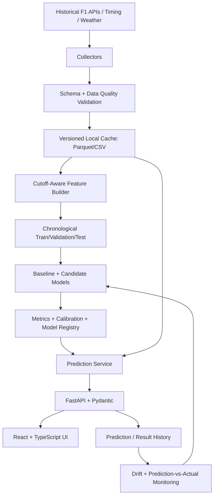

# Architecture

## Backend modules
- `src/data/`: provider adapters, caching and source schemas.
- `src/features/`: feature definitions and cutoff enforcement.
- `src/models/`: baseline, training, evaluation, calibration and persistence.
- `src/services/`: prediction orchestration and history.
- `api/`: HTTP contract, validation and error handling.
- `frontend/`: user-facing product.

## Data flow
1. Collect only required season/event/session data.
2. Cache raw responses with source, fetch time and checksum metadata.
3. Normalize into consistent tables; retain raw data for auditability.
4. Validate keys, duplicates, plausible values and cross-table joins.
5. Build feature rows as-of each prediction cutoff.
6. Train using earlier events/seasons and evaluate on later events.
7. Save model, feature schema, training window, metrics and code/config version.
8. Serve only a compatible model and complete enough input data.
9. Log prediction snapshots; compare with actual results when available.

## Reliability
- Provider adapters have timeouts, bounded retries and clear failure states.
- Cache lets the app serve known historical data during provider outages.
- Never silently substitute fabricated data.
- Data freshness is surfaced in the UI and API.
